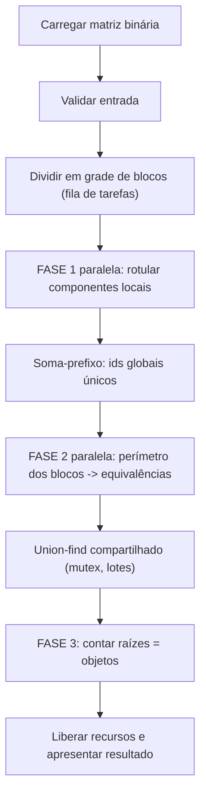
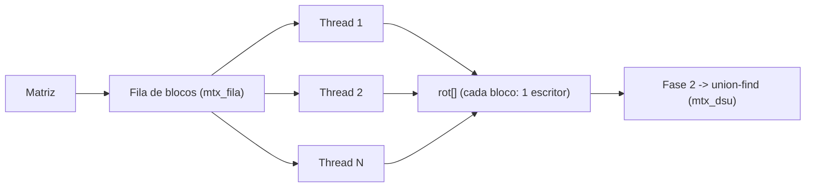
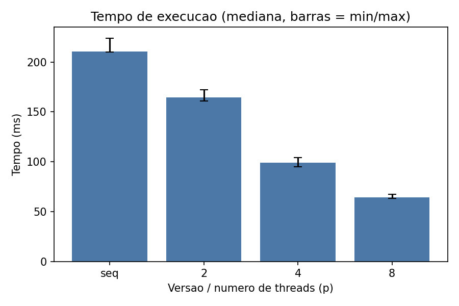
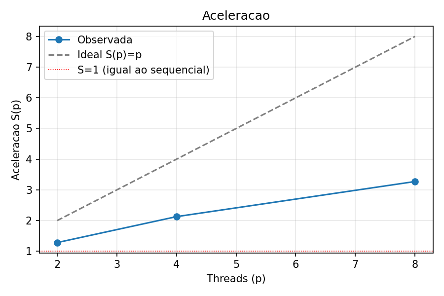
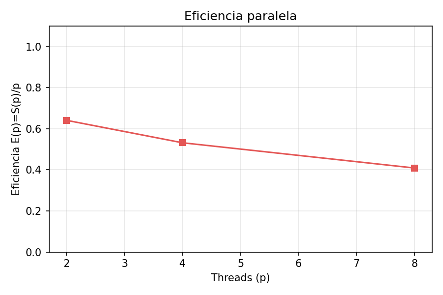

# Relatório técnico - Contagem paralela de objetos em uma matriz binária

> **Disciplina:** Sistemas Operacionais - 2026/II  
> **Professor:** Prof. Filipo Novo Mór  
> **Instituição:** Pontifícia Universidade Católica do Rio Grande do Sul - Escola Politécnica  
> **Repositório:** [rafafcardoso/T1-SISOP](https://github.com/rafafcardoso/T1-SISOP)  
> **Versão do relatório:** 1.0  
> **Data:** 04/10/2026

## Identificação

| Campo | Informação |
|---|---|
| Integrante 1 | Rafael da Fontoura Cardoso |
| Matrícula do integrante 1 | 24102573 |
| Integrante 2 | Não se aplica |
| Matrícula do integrante 2 | Não se aplica |
| Modalidade | Individual |
| Turma | [330] |
| Estratégia paralela | Pthreads |
| Plataforma testada | Linux x86_64 (Ubuntu 24.04, gcc 13.3.0) nos testes funcionais registrados em `results/testes.txt`; Ubuntu sob WSL2 em Windows 11 (gcc 15.2.0) nas medições de desempenho |
| Commit avaliado | [PREENCHER `HASH_DO_COMMIT`] |

## Resumo

Este trabalho resolve a contagem de objetos (componentes conexos de células `1`, conectividade 8) em matrizes binárias. A versão sequencial, referência de correção e desempenho, usa flood fill iterativo com pilha explícita e vetor de visitados. A versão paralela usa Pthreads: a matriz é dividida em blocos distribuídos por uma fila dinâmica de tarefas; cada thread rotula os componentes locais, depois analisa o perímetro dos blocos e registra equivalências em um union-find compartilhado, protegido por mutex e atualizado em lotes. O número de objetos é o número de raízes do union-find. As cinco matrizes obrigatórias, 12 casos adicionais e 240 execuções aleatórias coincidiram com a referência, e ThreadSanitizer e AddressSanitizer não reportaram problemas. Em uma matriz 4000 x 4000 (488.981 objetos), num Ryzen 5 5600X sob WSL2, a mediana caiu de 210,69 ms (sequencial) para 164,28, 99,03 e 64,39 ms com 2, 4 e 8 threads (aceleração 1,28, 2,13 e 3,27; eficiência 0,64, 0,53 e 0,41). O ganho é real, mas sublinear: parte do custo vem de trabalho extra do algoritmo paralelo e de limites de memória.

**Palavras-chave:** sistemas operacionais; paralelismo; processos; threads; conectividade 8; flood fill; componentes conexos.

## 1. Visão geral do problema

O programa recebe uma matriz binária na qual `0` representa o fundo e `1` representa o primeiro plano. Um objeto corresponde a um componente de células de valor `1` conectadas horizontalmente, verticalmente ou diagonalmente, conforme a **conectividade 8**.

O projeto contém duas implementações funcionalmente equivalentes:

1. uma versão sequencial, usada como referência de correção e de desempenho;
2. uma versão paralela baseada em **Pthreads**.

### 1.1 Objetivos da implementação

- Contar corretamente os objetos com conectividade 8.
- Distribuir trabalho efetivo entre pelo menos duas unidades de execução.
- Reconhecer e unificar objetos que atravessam as divisões da matriz.
- Produzir resultados determinísticos e idênticos nas versões sequencial e paralela.
- Evitar condições de corrida, deadlocks, atualizações perdidas e contagens duplicadas.
- Avaliar correção, sobrecarga, escalabilidade, aceleração e eficiência.

### 1.2 Requisitos atendidos

| Requisito | Como foi atendido | Evidência no repositório |
|---|---|---|
| ANSI C C89/C90 | Compilação com `-std=c89 -Wall -Wextra -pedantic`, sem avisos; declarações no início dos blocos, sem `//`, sem tipos C99. | [`Makefile`](Makefile), [`src/`](src/) |
| Conectividade 8 | Vetores `DL`/`DC` com os 8 deslocamentos; na fronteira, 4 vizinhos "para frente" cobrem os 8 sentidos. | `DL`, `DC`, `FL`, `FC` em [`src/conta-objetos-paralelo.c`](src/conta-objetos-paralelo.c) |
| Versão sequencial | Flood fill iterativo + vetor de visitados. | [`src/conta-objetos-sequencial.c`](src/conta-objetos-sequencial.c) |
| Versão paralela | Pthreads, blocos, fila dinâmica, union-find. | [`src/conta-objetos-paralelo.c`](src/conta-objetos-paralelo.c) |
| Duas ou mais unidades concorrentes | `-t N` cria N threads em cada fase paralela; a saída informa as tarefas executadas por thread. | `bin/conta-objetos-paralelo ARQ -t 4` |
| Quantidade configurável de trabalhadores | Opção `-t` (1 a 256) e grade `-b L C`. | `main()` do paralelo |
| Consolidação entre regiões | Fase 2 (perímetro dos blocos) + union-find compartilhado. | `analisa_fronteira`, `trata_celula`, `dsu_union` |
| Tratamento horizontal, vertical e diagonal | Matrizes obrigatórias 2 a 5, `diagonal`, `antidiagonal`, `xadrez`, `cruz_blocos`; mutação que remove uma diagonal é detectada. | [`results/testes.txt`](results/testes.txt) |
| Verificação das chamadas POSIX | Retornos de `pthread_create/join`, `mutex_init/lock/unlock/destroy` e `clock_gettime` verificados. | `executa_fase`, `proxima_tarefa`, `descarrega_lote`, `conta_paralelo` |
| Liberação dos recursos | Join de todas as threads criadas, destroy dos mutexes, `free` de todos os buffers; sem vazamentos no AddressSanitizer. | [`results/sanitizers.txt`](results/sanitizers.txt) |
| Compilação reproduzível | `make`. | [`Makefile`](Makefile) |

## 2. Organização do repositório

```text
.
├── README.md
├── RELATORIO_TECNICO.md
├── Makefile
├── src/
│   ├── conta-objetos-sequencial.c
│   ├── conta-objetos-paralelo.c
│   ├── gera-matriz.c
│   ├── matriz.c / matriz.h
│   └── pilha.c / pilha.h
├── tests/
│   ├── obrigatorios/        (exemplo1..5.txt + esperados.txt)
│   ├── adicionais/          (12 casos + esperados.txt)
│   ├── run_tests.sh
│   ├── bench.sh
│   └── graficos.py
└── results/
    ├── testes.txt
    └── sanitizers.txt        (+ medicoes.csv, resumo.md e gráficos após `make bench`)
```

| Caminho | Finalidade |
|---|---|
| `src/conta-objetos-sequencial.c` | Implementação sequencial de referência. |
| `src/conta-objetos-paralelo.c` | Implementação paralela (Pthreads). |
| `src/matriz.[ch]` | Entrada (leitura/validação), relógio monotônico, conversão de argumentos. |
| `src/pilha.[ch]` | Pilha dinâmica usada pelo flood fill iterativo. |
| `src/gera-matriz.c` | Gerador de matrizes pseudoaleatórias reprodutíveis (xorshift32 próprio). |
| `tests/obrigatorios/` | Cinco matrizes obrigatórias do enunciado. |
| `tests/adicionais/` | Doze casos adicionais com resultado esperado conhecido. |
| `tests/run_tests.sh` | Suíte automatizada de correção e determinismo. |
| `tests/bench.sh`, `tests/graficos.py` | Medição de desempenho e geração dos gráficos. |
| `results/` | Logs de testes e sanitizers; dados brutos das medições. |

## 3. Ambiente de desenvolvimento e execução

### 3.1 Hardware e software

| Item | Especificação |
|---|---|
| Processador | AMD Ryzen 5 5600X 6-Core Processor |
| Núcleos físicos | 6 |
| Processadores lógicos | 12 (SMT) |
| Memória RAM | [16GB] |
| Sistema operacional | Windows 11 com WSL2 (Ubuntu; kernel Linux 6.6.87.2-microsoft-standard-WSL2) |
| Arquitetura | x86_64 |
| Compilador | gcc 13.3.0 (testes funcionais) / cc (Ubuntu) 15.2.0 (medições) |
| Padrão da linguagem | C89/C90 |
| APIs POSIX utilizadas | `pthread_create`, `pthread_join`, `pthread_mutex_init/lock/unlock/destroy`, `clock_gettime` |
| Flags de compilação | `-std=c89 -Wall -Wextra -pedantic -O2` (+ `-pthread`) |

> Os arquivos `results/ambiente.txt` (gerado pelo `bench.sh`) contêm essas informações automaticamente.

### 3.2 Compilação

```bash
make clean
make
```

Ou, sem `make`:

```bash
cc -std=c89 -Wall -Wextra -pedantic src/conta-objetos-sequencial.c src/matriz.c src/pilha.c -o conta-objetos-sequencial
cc -std=c89 -Wall -Wextra -pedantic -pthread src/conta-objetos-paralelo.c src/matriz.c src/pilha.c -o conta-objetos-paralelo
```

### 3.3 Execução

```bash
bin/conta-objetos-sequencial ARQUIVO [-r REPETICOES]
bin/conta-objetos-paralelo ARQUIVO [-t THREADS] [-b BLOCOS_L BLOCOS_C] [-r REPETICOES] [-v]
```

**Exemplo reproduzível:**

```bash
bin/conta-objetos-sequencial tests/obrigatorios/exemplo3.txt
bin/conta-objetos-paralelo tests/obrigatorios/exemplo3.txt -t 4 -b 2 2
```

### 3.4 Formato da entrada e da saída

A matriz é lida de um arquivo texto: primeira linha `LINHAS COLUNAS`, seguida das células `0`/`1` por linha (com ou sem espaços). A leitura valida o cabeçalho, caracteres inválidos, falta ou excesso de células e o limite de células (rótulos `unsigned int`). A quantidade de threads vem de `-t` e a grade de blocos de `-b`.

```text
$ bin/conta-objetos-paralelo tests/obrigatorios/exemplo5.txt -t 4 -b 3 3
versao: paralela (pthreads)
arquivo: tests/obrigatorios/exemplo5.txt
dimensoes: 12 x 12
threads: 4 (efetivas: 4)
blocos: 3 x 3
tarefas_por_thread_fase1: <blocos processados por cada thread; varia entre execuções>
tarefas_por_thread_fase2: <idem>
rep 1 tempo_ms 0.264
componentes_locais: 13
unioes_nas_fronteiras: 6
objetos: 7
```

## 4. Arquitetura da solução

### 4.1 Fluxo geral



### 4.2 Estruturas de dados principais

| Estrutura | Tipo/representação | Responsabilidade | Compartilhada? | Proteção utilizada |
|---|---|---|---|---|
| Matriz de entrada | `unsigned char[linhas*colunas]` | Armazenar `0` e `1` | Sim (somente leitura) | Não se aplica (imutável) |
| Rótulos locais | `unsigned int[linhas*colunas]`, 0 = fundo | Distinguir componentes por bloco | Sim, mas cada bloco é escrito por uma única thread (fase 1) e só lido na fase 2 | Particionamento + `join` entre fases |
| Pilha do flood fill | `Pilha` (vetor dinâmico) | Percorrer um componente sem recursão | Não (uma por thread) | Não se aplica |
| Tarefas/regiões | Contador `proxima` (índice de bloco) | Fila dinâmica de blocos | Sim | `mtx_fila` |
| Limites dos blocos | `ini_l`, `ini_c`, `faixa_l`, `faixa_c` | Mapear linha/coluna ↔ faixa | Sim (somente leitura) | Não se aplica |
| Deslocamentos | `desloc[bloco]` | Tornar ids únicos entre blocos | Sim (somente leitura) | Calculado pela `main` entre as fases |
| Equivalências | `pai[]` (union-find) | Unificar componentes entre blocos | **Sim (escrita)** | `mtx_dsu` |
| Lote de equivalências | `Lote` (512 pares) | Reduzir a frequência de lock | Não (um por thread) | Não se aplica |
| Resultados locais | `ncomp[bloco]` | Contagem de componentes por bloco | Sim, cada posição escrita por uma thread | `join` |

## 5. Implementação sequencial

### 5.1 Algoritmo

A matriz é percorrida em ordem de linhas. Ao encontrar uma célula `1` ainda não visitada, incrementa-se o contador de objetos e executa-se um flood fill que marca todas as células conectadas. O flood fill é **iterativo**: uma pilha dinâmica guarda os índices pendentes e a célula é marcada como visitada **ao ser empilhada**, de modo que cada célula entra na pilha no máximo uma vez. Os oito vizinhos são testados com os deslocamentos `DL = {-1,-1,-1,0,0,1,1,1}` e `DC = {-1,0,1,-1,1,-1,0,1}`, com verificação de limites.

### 5.2 Pseudocódigo

```text
FUNÇÃO contar_objetos_sequencial(matriz):
    visitado <- vetor de zeros do tamanho da matriz
    contador <- 0
    PARA CADA célula i EM ORDEM:
        SE matriz[i] = 1 E visitado[i] = 0:
            contador <- contador + 1
            visitado[i] <- 1; empilha(i)
            ENQUANTO pilha não vazia:
                a <- desempilha()
                PARA CADA um dos 8 vizinhos v de a, dentro da matriz:
                    SE matriz[v] = 1 E visitado[v] = 0:
                        visitado[v] <- 1; empilha(v)
    RETORNA contador
```

### 5.3 Complexidade e uso de memória

| Aspecto | Análise | Justificativa |
|---|---|---|
| Complexidade de tempo | O(N), N = linhas x colunas | Cada célula é empilhada no máximo uma vez e examina 8 vizinhos. |
| Complexidade de espaço | O(N) | Matriz (1 byte/célula) + visitados (1 byte/célula) + pilha (até 4 bytes/célula no pior caso). |
| Risco de recursão excessiva | Não existe | Flood fill iterativo com pilha no heap, que cresce por dobra; um objeto de milhões de células não estoura a pilha de chamadas. |

## 6. Implementação paralela

### 6.1 Modelo de concorrência

| Decisão | Escolha do grupo | Justificativa |
|---|---|---|
| Unidade de execução | Thread POSIX | Compartilham a matriz e os rótulos sem cópia nem IPC; consolidação direta em memória. |
| Quantidade de trabalhadores | `-t N` (1 a 256) | Permite os experimentos de escalabilidade. Threads além do número de blocos não são criadas. |
| Divisão do trabalho | Grade de blocos `NBL x NBC` (`-b`); padrão `N x 1` | Blocos reproduzem as divisões ilustradas no enunciado e tornam as fronteiras explícitas. |
| Escalonamento | Dinâmico (fila de blocos) | Balanceia a carga quando os blocos têm custos diferentes e permite mais blocos do que threads. |
| Comunicação | Memória compartilhada | Rótulos em vetor global; equivalências no union-find compartilhado. |
| Sincronização | Dois mutexes + `join` como barreira | `mtx_fila` (tarefas), `mtx_dsu` (union-find). `join` é portável (macOS não tem `pthread_barrier`). |

### 6.2 Decomposição da matriz

Para dividir `n` linhas (ou colunas) em `k` faixas, cada faixa recebe `n/k` itens e as primeiras `n%k` faixas recebem um item a mais. Assim, matrizes não divisíveis (por exemplo 9x12 em 3x3, ou 5x5 em 2x2) funcionam sem faixas vazias. Se `-b` pedir mais faixas do que linhas/colunas, a grade é reduzida (o teste com `-b 1000 1000` resulta em **um bloco por célula**, o caso mais extremo de fronteiras). Se houver mais blocos do que threads, a fila dinâmica entrega o próximo bloco livre à thread que terminar primeiro.



### 6.3 Paralelismo efetivo

O cálculo que roda simultaneamente é o **flood fill local de cada bloco** (fase 1, a etapa dominante, O(N)) e a **análise do perímetro dos blocos** (fase 2). Os blocos são independentes na fase 1: cada um lê a matriz compartilhada (somente leitura) e escreve apenas nas próprias posições de `rot[]`. A saída do programa inclui `tarefas_por_thread_fase1/2`, que mostra quantos blocos cada thread processou.

| Etapa | Sequencial ou paralela? | Unidade responsável | Motivo |
|---|---|---|---|
| Leitura da matriz | Sequencial | `main` | E/S de arquivo; fora da medição de tempo. |
| Particionamento | Sequencial | `main` | O(NBL + NBC + linhas + colunas), desprezível. |
| Identificação local (fase 1) | **Paralela** | Threads | Blocos independentes; é a maior parte do custo. |
| Soma-prefixo dos ids | Sequencial | `main` | O(nº de blocos); depende de todos os resultados da fase 1. |
| Inicialização do union-find | Sequencial | `main` | O(componentes locais); parte que limita a aceleração (Lei de Amdahl). |
| Análise das fronteiras (fase 2) | **Paralela** | Threads | Custo proporcional ao perímetro dos blocos. |
| Aplicação das equivalências | Serializada pelo mutex | Threads | Trecho curto, em lotes de 512. |
| Contagem final (fase 3) | Sequencial | `main` | Percorre as raízes; O(componentes locais). |

### 6.4 Sincronização, comunicação e regiões críticas

| Recurso/dado | Risco concorrente | Mecanismo usado | Escopo da proteção | Justificativa |
|---|---|---|---|---|
| Índice da próxima tarefa (`proxima`) | Dois blocos entregues à mesma thread / tarefa perdida | `mtx_fila` | Verificar e incrementar o contador | Garante que cada bloco é processado exatamente uma vez. |
| Union-find (`pai[]`, `unioes`) | Atualização perdida, estrutura corrompida | `mtx_dsu` | Aplicação de um lote inteiro de equivalências | Um lock por 512 pares, não por par; `find` com compressão de caminho também escreve, então tudo ocorre sob o lock. |
| `rot[]` na fase 1 | Escrita simultânea na mesma célula | Particionamento (cada bloco tem um único escritor) | Sem lock | Elimina contenção no caso dominante. |
| `rot[]` entre as fases | Leitura de valor não finalizado | `pthread_join` (barreira) | Entre fases | O `join` garante *happens-before* entre as escritas da fase 1 e as leituras da fase 2. |
| `ncomp[]` | Escrita concorrente | Cada posição é escrita por uma thread; `join` | Sem lock | Posições distintas. |

**Ausência de deadlock.** Existem apenas dois mutexes e uma thread **nunca mantém um deles enquanto tenta adquirir o outro** (`proxima_tarefa` libera `mtx_fila` antes de qualquer trabalho; `descarrega_lote` só mexe em `mtx_dsu`). Sem espera circular, não há deadlock. Todos os retornos de lock/unlock são verificados. Os mutexes são destruídos ao final de `conta_paralelo`, inclusive em caminhos de erro.

## 7. Consolidação dos componentes

Somar as contagens locais está errado: o exemplo 3 com blocos 2x2 tem **8** componentes locais, mas apenas **5** objetos; o objeto central foi dividido em quatro pedaços, um em cada bloco.

### 7.1 Identificação local

Na fase 1, cada componente local recebe um rótulo `1..n` dentro do seu bloco (0 = fundo). Após a fase 1, a `main` calcula a soma-prefixo `desloc[b]` (soma dos componentes dos blocos anteriores). O **id global** de uma célula é `desloc[bloco] + rot - 1`, de modo que ids de blocos diferentes nunca colidem antes da consolidação. O bloco de uma célula é obtido em O(1) pelos vetores `faixa_l[linha]` e `faixa_c[coluna]`.

### 7.2 Verificação das fronteiras

Cada tarefa da fase 2 percorre só o **perímetro** do bloco (última linha, primeira e última colunas) e, para cada célula `1`, examina 4 vizinhos "para frente": `(l,c+1)`, `(l+1,c-1)`, `(l+1,c)`, `(l+1,c+1)`. Todo par de vizinhos (8 sentidos) aparece exatamente uma vez como "para frente" de uma de suas células. Se o par cruza blocos, uma das células está obrigatoriamente no perímetro do seu bloco; logo, a varredura é completa.

| Situação | Pares de células verificados | Como a equivalência é registrada |
|---|---|---|
| Fronteira horizontal | `(l,c)` com `(l+1,c)` quando `l` é a última linha do bloco | `(id_a, id_b)` no lote, depois `dsu_union` |
| Fronteira vertical | `(l,c)` com `(l,c+1)` quando `c` é a última coluna do bloco | idem |
| Conexão diagonal | `(l,c)` com `(l+1,c+1)` e `(l+1,c-1)` | idem |
| Encontro de quatro blocos | A célula do canto de um bloco liga-se ao canto do bloco diagonal; as demais ligações usam as regras acima | idem; o union-find fecha a transitividade entre os 4 blocos |

### 7.3 Unificação e contagem global

O union-find usa compressão de caminho (*path halving*) e sempre mantém como raiz o **menor id**, o que torna o representante determinístico. Cada thread acumula equivalências em um lote local (descartando repetições imediatas) e aplica o lote inteiro sob `mtx_dsu` quando ele enche e ao fim da fase. Terminada a fase 2, a `main` conta as raízes (`pai[i] == i`). Como consistência, verifica o invariante `objetos == componentes_locais - uniões_efetivas` (cada união efetiva reduz em 1 o número de conjuntos); se falhar, o programa aborta com erro interno.

### 7.4 Exemplo rastreável

Exemplo 3 (8x8) com `-t 4 -b 2 2 -v` (as barras indicam as fronteiras dos blocos):

```text
[antes da consolidacao] id global de cada componente local
   1 1 . . | . . . .
   1 . . . | . . . .
   . . . . | . . 3 .
   . . . 2 | 4 . 3 .
  ------------------
   . . . 5 | 7 . . .
   . . . . | . . . .
   . . 6 . | . . . 8
   . . 6 . | . . 8 8

[equivalencias] id -> representante (menor id do objeto)
  4 -> 2
  5 -> 2
  7 -> 2

[depois da consolidacao] objeto de cada celula (1..5)
   1 1 . . | . . . .
   1 . . . | . . . .
   . . . . | . . 2 .
   . . . 3 | 3 . 2 .
  ------------------
   . . . 3 | 3 . . .
   . . . . | . . . .
   . . 4 . | . . . 5
   . . 4 . | . . 5 5
```

| Região (bloco) | Rótulo local → id global | Células de fronteira relevantes | Equivalência global |
|---|---|---|---|
| Superior esquerdo | `2` | `(3,3)` | `(3,3)`–`(3,4)` horizontal; `(3,3)`–`(4,4)` **diagonal** |
| Superior direito | `4` | `(3,4)` | `4 -> 2` |
| Inferior esquerdo | `5` | `(4,3)` | `(3,3)`–`(4,3)` vertical; `5 -> 2` |
| Inferior direito | `7` | `(4,4)` | `(3,3)`–`(4,4)` diagonal (encontro dos 4 blocos); `7 -> 2` |

Resultado: 8 componentes locais, 3 uniões efetivas, **5 objetos**. Para o exemplo 5, a diagonal longa atravessa 3 blocos; ver o erro produzido pela mutação descrita na seção 8.1.

## 8. Correção e testes funcionais

### 8.1 Procedimento de validação

`tests/run_tests.sh` (acionado por `make test`) compara automaticamente a versão paralela com o valor esperado e com a sequencial em **12 configurações** (`-t 2/3/4/8`, grades `2x2`, `3x3`, `1x3`, `3x1`, `4x4` e `1000x1000`, esta última reduzida a um bloco por célula). Os valores esperados de todas as matrizes (obrigatórias e adicionais) foram verificados também por uma implementação independente em Python (BFS), de modo que um erro de transcrição das matrizes ou um erro comum às duas versões em C seria detectado.

Para garantir que os testes **conseguem falhar**, foram feitos testes de mutação:

- Removendo a diagonal `(l+1,c+1)` da análise de fronteiras: a suíte detectou o erro (exemplo 5: esperado 7, obtido 8, 9, 10 e 14, conforme o número de threads).
- Removendo o mutex do union-find: o ThreadSanitizer reportou `data race` em `dsu_union` e `descarrega_lote`. Com o código real, **zero avisos**.

### 8.2 Matrizes obrigatórias

Resultados com 4 threads (grade 2x2 nos exemplos 1 a 3 e 3x3 nos exemplos 4 e 5, conforme o enunciado). Os demais testes com outras configurações estão em [`results/testes.txt`](results/testes.txt).

| Exemplo | Dimensões | Objetos esperados | Resultado sequencial | Resultado paralelo | Componentes locais / uniões | Situação | Evidência |
|---:|---:|---:|---:|---:|---|---|---|
| 1 | 5 x 5 | 3 | 3 | 3 | 4 / 1 | Aprovado | [log](results/testes.txt) |
| 2 | 6 x 8 | 4 | 4 | 4 | 7 / 3 | Aprovado | [log](results/testes.txt) |
| 3 | 8 x 8 | 5 | 5 | 5 | 8 / 3 | Aprovado | [log](results/testes.txt) |
| 4 | 9 x 12 | 6 | 6 | 6 | 11 / 5 | Aprovado | [log](results/testes.txt) |
| 5 | 12 x 12 | 7 | 7 | 7 | 13 / 6 | Aprovado | [log](results/testes.txt) |

### 8.3 Casos de teste adicionais

Todos executados na versão sequencial e em 12 configurações paralelas; **todos aprovados**.

| ID | Arquivo | Dimensões | Característica avaliada | Esperado |
|---|---|---:|---|---:|
| A1 | `zeros.txt` | 7 x 9 | Matriz somente de zeros | 0 |
| A2 | `uns.txt` | 10 x 10 | Um único objeto ocupando todos os blocos | 1 |
| A3 | `unica_celula.txt` | 1 x 1 | Menor matriz possível | 1 |
| A4 | `linha_unica.txt` | 1 x 20 | Matriz com 1 linha (só fronteiras verticais) | 7 |
| A5 | `coluna_unica.txt` | 15 x 1 | Matriz com 1 coluna (só fronteiras horizontais) | 4 |
| A6 | `diagonal.txt` | 12 x 12 | Conexão somente diagonal (`\`) | 1 |
| A7 | `antidiagonal.txt` | 12 x 12 | Conexão somente diagonal (`/`) | 1 |
| A8 | `xadrez.txt` | 10 x 10 | Tabuleiro: um objeto ligado só por diagonais | 1 |
| A9 | `isoladas.txt` | 11 x 11 | 36 células isoladas (nada deve ser unido) | 36 |
| A10 | `serpentina.txt` | 15 x 15 | Objeto único e longo, cruza muitos blocos | 1 |
| A11 | `moldura.txt` | 13 x 17 | Objeto que contorna a matriz, 17 colunas não divisíveis | 1 |
| A12 | `cruz_blocos.txt` | 9 x 9 | Cruz no centro (encontro de blocos) | 1 |
| A13 | aleatórias | 1x1 a 53x61 | 20 matrizes (densidade 15% a 59%) x 12 configurações | = sequencial |
| A14 | `bench.sh` | 4000 x 4000 | Matriz grande usada no desempenho (densidade 35%, semente 42; 488.981 objetos) | = sequencial em todas as 28 medições (`resultado_correto = true`) |

### 8.4 Repetibilidade e determinismo

| Teste | Repetições | Configurações | Resultados idênticos? | Observações |
|---|---:|---|---|---|
| Matriz aleatória 200x300, densidade 40% | 50 | `-t 8 -b 4 4` | Sim (0 divergências) | O resultado não depende do escalonamento; o representante de cada objeto é sempre o menor id. |
| Repetições internas (`-r`) | N | Qualquer | Sim | O programa aborta se o resultado variar entre repetições. |

## 9. Avaliação de desempenho

### 9.1 Metodologia experimental

| Parâmetro | Valor adotado |
|---|---|
| Matriz ou conjunto de matrizes | Matriz aleatória 4000 x 4000 (16 milhões de células), densidade 35%, semente 42, gerada por `gera-matriz`; 488.981 objetos |
| Mesmos dados em todas as versões? | Sim. Mesmo arquivo para a versão sequencial e para a paralela |
| Relógio/API de medição | `clock_gettime(CLOCK_MONOTONIC, ...)` |
| Trecho medido | Do início do cálculo ao fim da contagem, incluindo alocação dos vetores auxiliares, criação e junção das threads e consolidação. **Exclui** a leitura do arquivo e a saída detalhada |
| Aquecimentos descartados | 1 (primeira repetição de cada configuração) |
| Repetições por configuração | 7 medidas, após o aquecimento |
| Medida representativa | Mediana (robusta a picos causados por outros processos) |
| Critério para dispersão | Mínimo e máximo |
| Carga do sistema durante os testes | Sem aplicativos pesados em segundo plano (WSL2 sobre Windows 11). O benchmark foi executado duas vezes; os dados aqui são os registrados em `results/` |
| Flags de otimização | `-O2` |
| Configurações paralelas | 2, 4 e 8 threads, grade padrão (uma faixa de linhas por thread) |

As medições brutas estão em [`results/medicoes.csv`](results/medicoes.csv) e o ambiente em [`results/ambiente.txt`](results/ambiente.txt).

### 9.2 Métricas

$$
S(p) = \frac{T_{sequencial}}{T_{paralelo}(p)} \qquad E(p) = \frac{S(p)}{p}
$$

### 9.3 Resultados consolidados

| Versão | Trabalhadores (`p`) | Tempo representativo (ms) | Dispersão, mín-máx (ms) | Aceleração `S(p)` | Eficiência `E(p)` | Resultado correto? |
|---|---:|---:|---:|---:|---:|---|
| Sequencial | 1 | 210,69 | 210,22 - 223,89 | 1,00 | 1,00 | Sim |
| Paralela | 2 | 164,28 | 161,02 - 172,04 | 1,28 | 0,64 | Sim |
| Paralela | 4 | 99,03 | 94,87 - 104,22 | 2,13 | 0,53 | Sim |
| Paralela | 8 | 64,39 | 63,40 - 67,25 | 3,27 | 0,41 | Sim |

**Dados brutos das repetições** (ms):

| Versão | `p` | Rep. 1 | Rep. 2 | Rep. 3 | Rep. 4 | Rep. 5 | Rep. 6 | Rep. 7 | Mediana |
|---|---:|---:|---:|---:|---:|---:|---:|---:|---:|
| Sequencial | 1 | 223,894 | 210,583 | 211,594 | 210,637 | 212,744 | 210,216 | 210,692 | 210,692 |
| Paralela | 2 | 164,284 | 168,496 | 161,643 | 161,020 | 162,210 | 172,044 | 169,988 | 164,284 |
| Paralela | 4 | 99,031 | 94,868 | 104,225 | 98,382 | 95,283 | 100,792 | 102,715 | 99,031 |
| Paralela | 8 | 67,245 | 63,665 | 65,748 | 63,398 | 64,010 | 64,395 | 64,497 | 64,395 |

### 9.4 Gráficos



**Figura 1 -** Tempo de execução (mediana; barras de erro = mínimo e máximo das 7 repetições). Fonte: elaborado pelo autor.



**Figura 2 -** Aceleração observada em função do número de threads. A linha tracejada é a aceleração ideal `S(p) = p`. Fonte: elaborado pelo autor.



**Figura 3 -** Eficiência paralela `E(p) = S(p)/p`. Fonte: elaborado pelo autor.

### 9.5 Análise dos resultados

**Ganho sobre a versão sequencial.** A versão paralela foi mais rápida em todas as configurações. Com 8 threads o tempo caiu de 210,69 ms para 64,39 ms (redução de cerca de 69%), aceleração de 3,27. Em nenhum caso a versão paralela foi mais lenta que a sequencial, portanto não há resultado de `S(p) < 1` a explicar. As medições são estáveis: a dispersão entre as 7 repetições é pequena (por exemplo, 63,40 a 67,25 ms com 8 threads). O valor máximo da versão sequencial (223,89 ms) é a primeira repetição após o aquecimento, e a mediana não é afetada por ele.

**Aceleração sublinear.** A aceleração cresce com o número de threads, mas bem abaixo do ideal (`S(p) = p`), e a eficiência cai de 0,64 (2 threads) para 0,53 (4) e 0,41 (8). Isso era esperado pelos seguintes motivos. As explicações abaixo são hipóteses consistentes com a arquitetura do programa; **não foram isoladas com medições específicas**:

- **Trabalho extra do algoritmo paralelo.** A versão paralela não é a sequencial dividida em partes: ela mantém um vetor de rótulos de 4 bytes por célula (64 MB nesta matriz, contra 16 MB do vetor de visitados da sequencial), executa uma segunda fase de análise de fronteiras e usa um union-find. Isso explica por que a eficiência já é de apenas 0,64 com 2 threads. Mesmo com `p = 1`, o algoritmo paralelo faria mais trabalho que o sequencial.
- **Trechos que permanecem sequenciais** (limite de Amdahl): a soma-prefixo, a inicialização do vetor `pai` do union-find e a contagem final de raízes, todos proporcionais ao número de componentes locais, que aqui é da ordem de meio milhão. A aplicação das equivalências no union-find é serializada pelo mutex, mas feita em lotes de 512 para reduzir a contenção. Os dois pontos de junção (`join`) entre as fases também têm custo.
- **Memória.** O flood fill faz acessos a 8 vizinhos em uma matriz de 16 milhões de células mais os vetores auxiliares. É um problema com alta demanda de memória, e todos os núcleos compartilham o cache L3 e a banda de memória, o que reduz o ganho conforme mais threads são usadas.
- **Mais threads que núcleos físicos.** O processador tem 6 núcleos físicos e 12 lógicos (SMT). Com 8 threads, dois núcleos físicos passam a executar duas threads cada, que competem pelas mesmas unidades de execução e caches; isso reduz o ganho por thread adicional (a eficiência cai de 0,53 para 0,41).
- **Ambiente.** As medições foram feitas sob WSL2, que acrescenta uma camada de virtualização sobre o Windows 11, o que pode introduzir alguma variação.

**Granularidade e balanceamento.** Com a grade padrão (uma faixa de linhas por thread) cada thread processa praticamente um bloco, de modo que o escalonamento é quase estático. Como a matriz é aleatória e uniforme, o desbalanceamento esperado é pequeno. Grades com mais blocos do que threads (`-b`) equilibrariam melhor matrizes não uniformes, ao custo de mais fronteiras para consolidar.

**Experimentos que ajudariam a confirmar as hipóteses** (não realizados): medir a versão paralela com `-t 1` (separa o custo extra do algoritmo do ganho de paralelismo), variar a grade `-b` e testar 12 threads (todos os processadores lógicos).

## 10. Tratamento de erros e qualidade do código

### 10.1 Chamadas e recursos POSIX

| Chamada/recurso | Erro verificado? | Ação em caso de falha | Liberação/finalização |
|---|---|---|---|
| `pthread_create` | Sim | Mensagem com `strerror`, aguarda as já criadas, aborta com código 2 | `pthread_join` de todas as criadas |
| `pthread_join` | Sim | Mensagem e código 2 | Chamado em todas as threads criadas |
| `pthread_mutex_init` | Sim | Mensagem; libera o que foi alocado | `pthread_mutex_destroy` |
| `pthread_mutex_lock/unlock` | Sim | Thread sinaliza erro, `main` aborta | - |
| `pthread_mutex_destroy` | Sim | Aviso em `stderr` | Em todos os caminhos (`goto fim`) |
| `clock_gettime` | Sim | Mensagem via `perror` | - |
| `fopen/fread/fscanf` | Sim | Mensagem; entrada inválida rejeitada com código 1 | `fclose` |
| `malloc/calloc/realloc` | Sim | Mensagem; libera o que já foi alocado; código 2 | `free` no fim de cada função |

### 10.2 Compilação e análise

| Verificação | Comando/ferramenta | Resultado |
|---|---|---|
| Compilação C89/C90 | `make` | Sem erros |
| Avisos do compilador | `-Wall -Wextra -pedantic` | Nenhum aviso (gcc 13.3.0) |
| Memória e comportamento indefinido | `make asan` (AddressSanitizer + UBSan + detecção de vazamento) | Suíte completa sem erros nem vazamentos |
| Condições de corrida | `make tsan` (ThreadSanitizer) | Suíte completa sem avisos; um mutante sem mutex foi detectado (seção 8.1) |

Logs em [`results/sanitizers.txt`](results/sanitizers.txt).

### 10.3 Separação de responsabilidades

Entrada, validação, relógio e conversão de argumentos ficam em `matriz.c`; a pilha em `pilha.c`; o algoritmo sequencial em seu próprio arquivo. No paralelo, as funções são separadas por papel: fila de tarefas (`proxima_tarefa`), fase 1 (`rotula_bloco`, `fase1`), fase 2 (`analisa_fronteira`, `trata_celula`, `descarrega_lote`, `fase2`), union-find (`dsu_find`, `dsu_union`), criação/junção das threads (`executa_fase`), orquestração (`conta_paralelo`) e saída didática (`imprime_detalhes`). Os testes ficam em `tests/`.

## 11. Limitações e decisões de projeto

| Limitação ou decisão | Impacto | Alternativa considerada | Motivo da escolha |
|---|---|---|---|
| Rótulos `unsigned int` (limite de ~4,29 bilhões de células) | Matrizes maiores são rejeitadas com erro claro | `unsigned long` / `size_t` | Metade da memória e melhor uso de cache |
| Rótulos locais por bloco + soma-prefixo | Soma-prefixo sequencial (barata) | Rótulo = índice da célula-semente (sem soma-prefixo, mas union-find com N posições) | Union-find compacto (só componentes locais) |
| `join` entre fases em vez de barreira | Threads recriadas na fase 2 (pequena sobrecarga) | `pthread_barrier_t` | Portabilidade: macOS não oferece barreiras POSIX |
| Um único mutex para o union-find | Serializa a aplicação das equivalências | Union-find sem lock (CAS) / um mutex por conjunto | Simplicidade e correção verificável; o uso de lotes reduz a contenção |
| Fase 3 e inicialização de `pai[]` sequenciais | Limitam a aceleração | Paralelizar a contagem de raízes | Custo pequeno frente à fase 1; justificado pela Lei de Amdahl |
| Somente Pthreads (sem processos) | - | Processos com `fork` + memória compartilhada | O enunciado permite Pthreads; o compartilhamento direto simplifica a consolidação |

## 12. Conclusão

Os objetivos do trabalho foram alcançados. As duas versões contam corretamente os objetos com conectividade 8: as cinco matrizes obrigatórias deram os resultados esperados (3, 4, 5, 6 e 7), assim como 12 casos adicionais e 240 execuções sobre matrizes aleatórias em 12 configurações de threads e blocos, incluindo a configuração extrema de um bloco por célula. O resultado é determinístico (50 execuções idênticas), e ThreadSanitizer e AddressSanitizer/UBSan não reportaram problemas. Os testes de mutação mostraram que a suíte detecta erros na consolidação das diagonais e a falta de mutex no union-find.

No desempenho, a versão paralela reduziu a mediana de 210,69 ms para 64,39 ms com 8 threads em uma matriz 4000 x 4000 (aceleração 3,27), com ganho em todas as configurações testadas (2, 4 e 8 threads). A eficiência decresce com o número de threads (0,64, 0,53 e 0,41), por causa do trabalho extra do algoritmo paralelo, dos trechos sequenciais, da pressão sobre a memória e do uso de mais threads do que núcleos físicos.

O principal aprendizado foi que paralelizar uma contagem de componentes conexos não é só dividir a matriz: somar as contagens locais está errado, e o ponto central do problema é reconhecer e unificar os rótulos que representam o mesmo objeto nas fronteiras. Isso exigiu decidir com cuidado o que pode ser feito sem sincronização (a rotulagem local, em que cada bloco tem um único escritor) e o que precisa de exclusão mútua (o union-find compartilhado). Como melhoria futura realista, a contagem final de raízes e a inicialização do union-find poderiam ser paralelizadas, e um union-find sem lock reduziria a serialização na consolidação.

## 13. Vídeo de apresentação

| Campo | Informação |
|---|---|
| Plataforma | [YouTube / Vimeo] |
| Link privado ou não listado | [INSERIR URL COMPLETA] |
| Duração | [MM:SS - máximo de 10 minutos] |
| Privacidade | [Não listado / privado compartilhado com o professor / protegido por senha] |
| Senha, se aplicável | [PREENCHER ou `Não se aplica`] |
| Data da última verificação do acesso | [DD/MM/AAAA] |

### 13.1 Conteúdo do vídeo

- [ ] Problema e estratégia escolhida.
- [ ] Implementação sequencial e referência de correção.
- [ ] Decomposição, threads e sincronização.
- [ ] Consolidação de objetos que atravessam regiões.
- [ ] Demonstração executável.
- [ ] Testes obrigatórios e adicionais.
- [ ] Resultados de desempenho.
- [ ] Conclusões.
- [ ] Participação de ambos os integrantes, quando o trabalho for em dupla.

## 14. Contribuições dos integrantes

| Atividade | Integrante 1 | Integrante 2 | Evidência/observação |
|---|---|---|---|
| Projeto da solução sequencial | 100% | Não se aplica | Trabalho individual |
| Projeto da solução paralela | 100% | Não se aplica | Trabalho individual |
| Sincronização/comunicação | 100% | Não se aplica | Trabalho individual |
| Consolidação | 100% | Não se aplica | Trabalho individual |
| Testes e medições | 100% | Não se aplica | Trabalho individual; medições executadas pelo autor em sua máquina |
| Documentação e vídeo | 100% | Não se aplica | Trabalho individual |

O autor declara compreender integralmente o código, as estruturas de dados, a divisão do trabalho, a sincronização, a comunicação, a consolidação e os resultados apresentados.

## 15. Ferramentas, bibliotecas, referências e códigos externos

| Recurso | Finalidade | Origem/link | Licença | Partes do projeto afetadas |
|---|---|---|---|---|
| libc e POSIX Threads | Execução, threads, mutexes, relógio | Sistema operacional | - | Todo o código |
| Flood fill e union-find (disjoint-set) | Algoritmos clássicos | Literatura de algoritmos (ex.: Cormen et al., *Introduction to Algorithms*, cap. de conjuntos disjuntos) | - | Sequencial e paralelo |
| ThreadSanitizer / AddressSanitizer / UBSan | Análise dinâmica | Incluídos no gcc/clang | - | Somente testes |
| Python 3 + matplotlib | Gráficos (tests/graficos.py) e conferência independente dos valores esperados | python.org / matplotlib.org | PSF / BSD | Somente análise, fora da solução |
| Editor de tabelas C (filipomor.com) | Preparar matrizes | https://filipomor.com/editor-tabelas-c | - | Não utilizado (as matrizes obrigatórias foram transcritas do enunciado e conferidas por contagem independente) |
| Claude (Anthropic) | Geração do código-fonte em C, dos scripts de teste e de medição e do esqueleto deste relatório; apoio ao estudo do código | claude.ai | Termos de uso do serviço | Todo o projeto. Única ferramenta de IA utilizada |
| Verificação dos resultados | O autor compilou e executou o código, rodou a suíte de testes e o benchmark em sua própria máquina, e conferiu os resultados | - | - | Testes (`make test`), sanitizers e medições |

## 16. Checklist de entrega

### Código e execução

- [x] O código segue ANSI C C89/C90.
- [x] O projeto compila em Linux ou macOS. *(Testado em Linux e em Ubuntu sob WSL2; macOS não testado)*
- [x] A compilação ocorre sem erros e sem avisos.
- [x] As principais chamadas POSIX têm os retornos verificados.
- [x] Todos os recursos são finalizados ou liberados corretamente.
- [x] A versão sequencial conta componentes com conectividade 8.
- [x] A versão paralela distribui cálculo real entre pelo menos duas unidades.
- [x] A quantidade de threads é configurável.
- [x] Conexões horizontais, verticais e diagonais são preservadas.
- [x] Componentes que atravessam regiões são consolidados sem duplicidade.
- [x] Não há condições de corrida, deadlocks ou atualizações perdidas conhecidas.

### Testes e desempenho

- [x] As cinco matrizes obrigatórias foram executadas nas duas versões.
- [x] A versão paralela produziu exatamente os mesmos resultados da sequencial.
- [x] Foi criada pelo menos uma matriz maior para o teste de desempenho.
- [x] Foram testadas pelo menos duas quantidades de threads (2, 4 e 8).
- [x] As medições foram repetidas e o valor representativo foi explicado.
- [x] Tempo sequencial, tempo paralelo, aceleração e eficiência foram informados.
- [x] Resultados em que a versão paralela foi mais lenta foram explicados. *(Não ocorreu; a aceleração sublinear foi analisada na seção 9.5.)*
- [ ] Dados brutos, tabelas e gráficos estão versionados no repositório. *(confirmar após o `push`)*

### Repositório e apresentação

- [ ] O repositório do GitHub está público.
- [x] `README.md` contém descrição, compilação, execução e arquitetura. *(preencher autoria)*
- [x] O `Makefile` permite compilação reproduzível.
- [x] As matrizes de teste e seus resultados estão incluídos.
- [x] A análise de desempenho está incluída.
- [ ] O link do vídeo está acessível e o vídeo tem até 10 minutos.
- [x] Ferramentas, referências, bibliotecas e códigos externos foram identificados.
- [ ] O hash do commit avaliado foi registrado neste relatório.

## Apêndice A - Registro de comandos

```bash
# Informações do ambiente
uname -a; cc --version; nproc

# Compilação
make clean && make

# Execução dos testes obrigatórios e adicionais
make test

# Análise dinâmica
make tsan
make asan

# Execução dos testes de desempenho
make bench
python3 tests/graficos.py
```

## Apêndice B - Formato dos dados brutos

`results/medicoes.csv` (gerado por `tests/bench.sh`):

```csv
matriz,linhas,colunas,versao,trabalhadores,repeticao,tempo_ms,objetos,resultado_correto
```

## Apêndice C - Correspondência com os critérios de avaliação

| Critério | Peso | Seções com evidências |
|---|---:|---|
| Correção sequencial e paralela, incluindo conectividade 8 | 2,0 | 5, 6, 7 e 8 |
| Decomposição do problema e paralelismo efetivo | 1,5 | 6.1, 6.2 e 6.3 |
| Sincronização, comunicação e ausência de condições de corrida | 1,5 | 6.4 e 10 |
| Consolidação de objetos que atravessam regiões | 1,5 | 7 |
| Testes obrigatórios, adicionais e análise de desempenho | 1,0 | 8 e 9 |
| Qualidade do código ANSI C e tratamento de erros | 1,0 | 3 e 10 |
| Organização do repositório e documentação | 0,5 | 2, 3 e 16 |
| Apresentação, demonstração e domínio da implementação | 1,0 | 13 e 14 |
